# Ableton Live routing with s3g Max for Live

The s3g devices use two different paths: Live's ordinary same-track chain and
private numbered buses between tracks. A bus number adds a destination; it
does not replace the direct path to the next device on the same track.

Install the s3g-dsp CLAP plugins and the matching s3g-clap-max release before
opening these devices. See the
[installation instructions](https://github.com/s3g/s3g-clap-max#install) if an
**EDITOR** button cannot open its plugin.

## Choose the path

| What you want to do | Device order | Bus setting |
| --- | --- | --- |
| Play a Live instrument from Relay or Tracker on the same track | MIDI effect → Live instrument | **MIDI OUT** can stay **OFF** |
| Play an instrument on another track | Relay or Tracker on one track; **s3g MIDI Bus to Live** → instrument on the other | Match sender **MIDI OUT** and bridge **MIDI IN**; optionally filter **MIDI CH** |
| Feed a multichannel processor on another track | **s3g Bus Send 36** → **s3g Bus Receive 36** → processor | Match the audio **BUS** numbers |
| Send decoded channels to interface outputs | Decoder or panner → **s3g Main Hardware Out 32** | Set Main's channel map and **HARDWARE** pairs |

The MIDI bus and the 36-channel audio bus are separate systems, even if they
show the same number.

## MIDI to a Live instrument

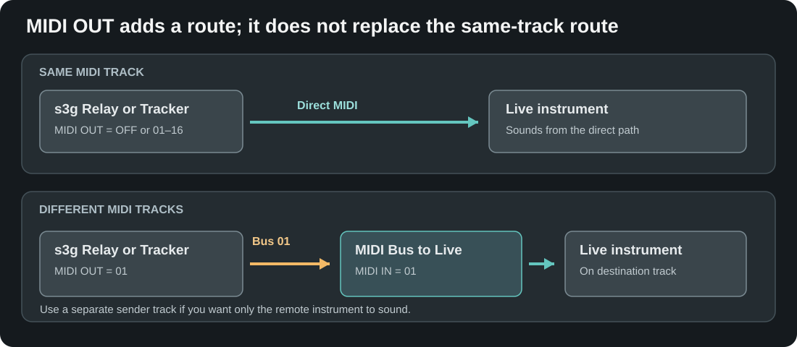

Relay's **MIDI OUT** and the bridge's **MIDI IN** use matching bus numbers:

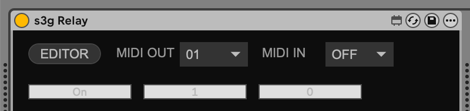

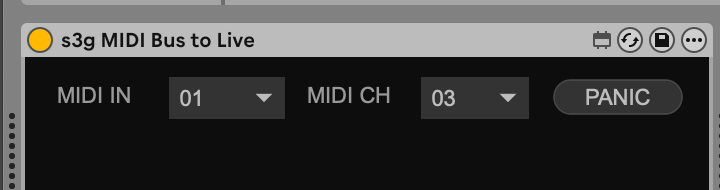

On one MIDI track, put **s3g Relay** or **s3g Tracker** before the instrument.
Generated MIDI reaches that instrument directly. Changing **MIDI OUT** to
**OFF**, **01**, or another number does not silence that same-track path.

For a different track, set the sender's **MIDI OUT** to a number such as **01**.
Put **s3g MIDI Bus to Live** before the destination instrument and set its
**MIDI IN** to **01**. Set **MIDI CH** to **ALL** for every channel, or select
**01–16** to pass only that channel from the bus. The bridge also passes that
track's ordinary incoming Live MIDI without applying this filter. Live's
**MIDI From** channel chooser does not filter the private bus at this point.
If the sender has an instrument after it *and* sends to a second
track, both instruments can sound. Keep the sender on its own MIDI track when
you want only the remote instrument.

For a receiving s3g instrument, select its matching **MIDI IN** instead of
using the bridge. The private bus preserves MIDI channel bytes; the receiving
CLAP's own channel setting still determines which notes it uses. Avoid
choosing the same **MIDI IN** and **MIDI OUT** on one MIDI effect: its private
bus output is suppressed to prevent a feedback loop.

## Stereo source to Ambisonics and hardware

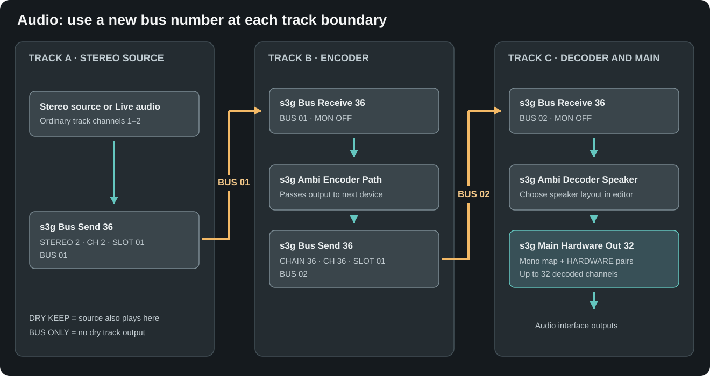

This example uses **s3g Ambi Encoder Path** and **s3g Ambi Decoder Speaker**.
Use two bus numbers because the encoder's input and output are different
signals.

1. On the source track, place **s3g Bus Send 36** after the stereo source. Set
   **INPUT = STEREO 2**, **CH = 2**, **BUS = 01**, and **SLOT = 01**. Choose
   **DRY KEEP** if the source should remain audible on its own track, or
   **BUS ONLY** if it should not.

   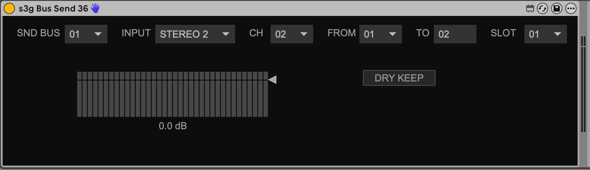

2. On the encoder track, put **s3g Bus Receive 36** immediately before
   **s3g Ambi Encoder Path**. Set **BUS = 01** and leave **MON = OFF** for a
   bus-only track. Put another **s3g Bus Send 36** after the encoder; set
   **INPUT = CHAIN 36**, **BUS = 02**, **CH = 36**, and **SLOT = 01**.

   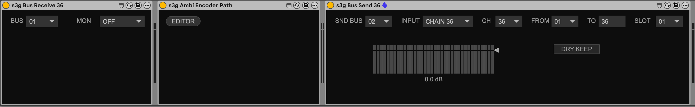

   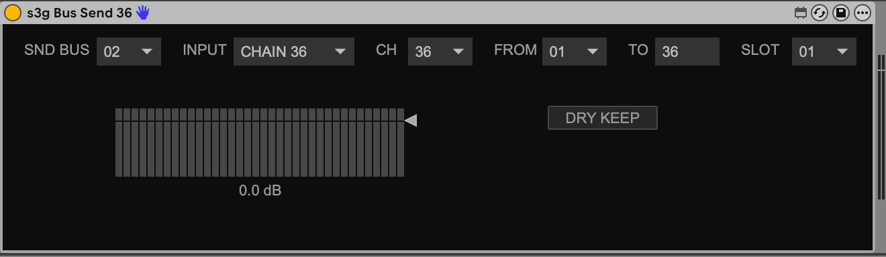

   For this stereo-source example, set Path's **INPUTS = 2** in its editor.
   Set **ORDER = 5OA** to produce 36 active Ambisonic channels. The Send's
   **CH = 36** transports those slots; it does not set the encoder's order.

   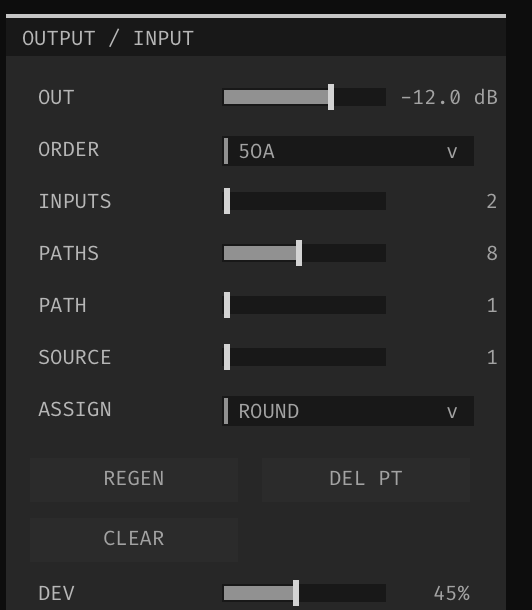

   [See the full Path editor screenshot](images/screenshots/ambi-encoder-path-editor-5oa-inputs-2.png).
3. On the decoder track, put **s3g Bus Receive 36** (**BUS = 02**) before
   **s3g Ambi Decoder Speaker**, followed by **s3g Main Hardware Out 32**.
   Configure the speaker layout in the decoder, then map its mono output
   channels and assign Live's stereo hardware pairs in Main.

   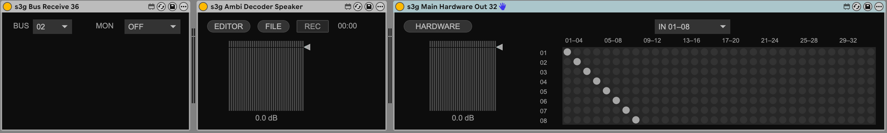

   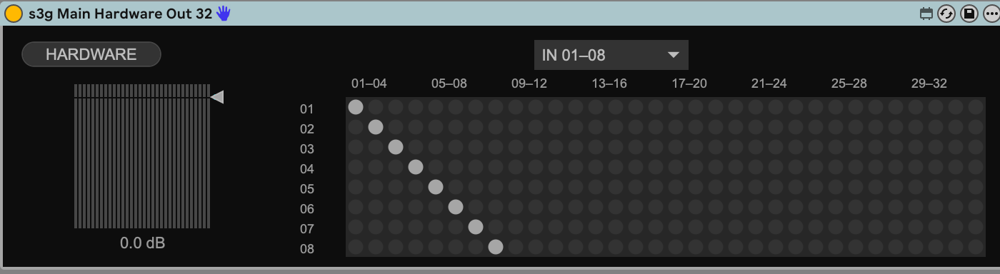

   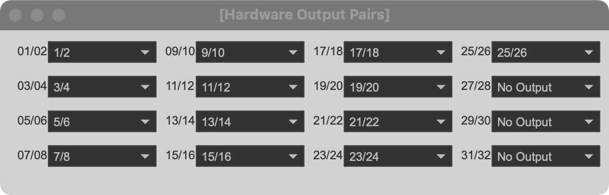

The encoder and decoder pass their multichannel signal to the *next device on
the same track* automatically; they have no hidden send or receive bus. To
cross a track boundary, place an explicit Send and Receive pair. Multiple
Sends can feed one bus and are summed at its Receive. Use one Receive
destination per audio bus number.

The audio bus has 36 slots, enough for fifth-order Ambisonics. Main can route
up to 32 decoded mono outputs to Live's hardware pairs; it is not a direct
36-channel Ambisonic hardware output. A stereo decoder instead returns to
Live's ordinary stereo track output and does not need Main.

## If you hear nothing or hear too much

| Symptom | Check |
| --- | --- |
| An instrument after Relay still plays with **MIDI OUT = OFF** | This is the direct same-track MIDI path; move the instrument to another track for bus-only use. |
| A remote instrument is silent | Match the sender's **MIDI OUT** to the bridge's or s3g receiver's **MIDI IN**; check the destination track's monitoring. |
| A multichannel processor is silent | Match audio **BUS** numbers; put Receive before the processor, and set Send's **INPUT** to **STEREO 2** or **CHAIN 36** as appropriate. |
| The audio bus sounds on the Receive track unexpectedly | Set Receive **MON = OFF**; monitoring is independent of the multichannel output to the next device. |
| Main has signal but the speakers are silent | Check the decoder's output format, Main's mono channel map, and its **HARDWARE** pair assignments. |

For device-specific channel counts, timing caveats, and detailed examples, see
the [full M4L routing reference](s3g-clap-m4l-routing.md).
